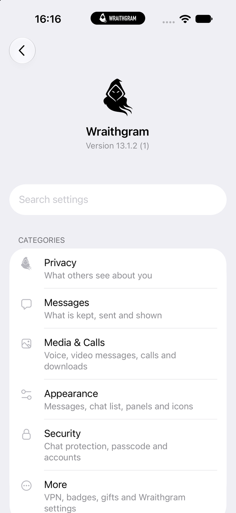
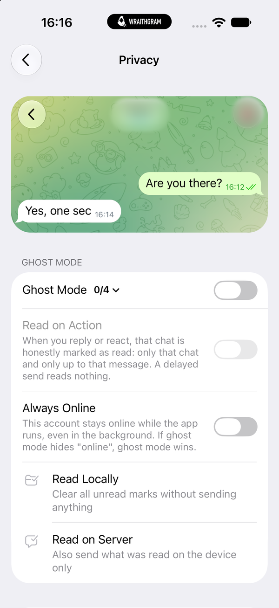
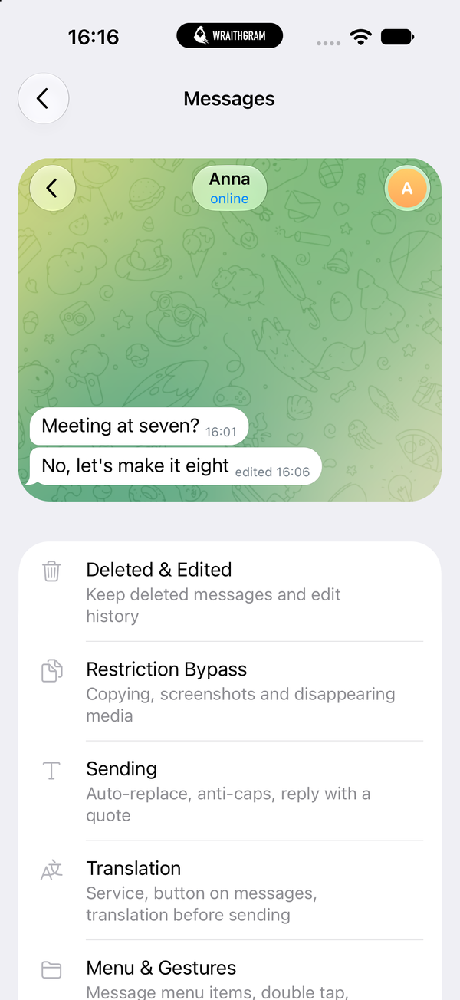
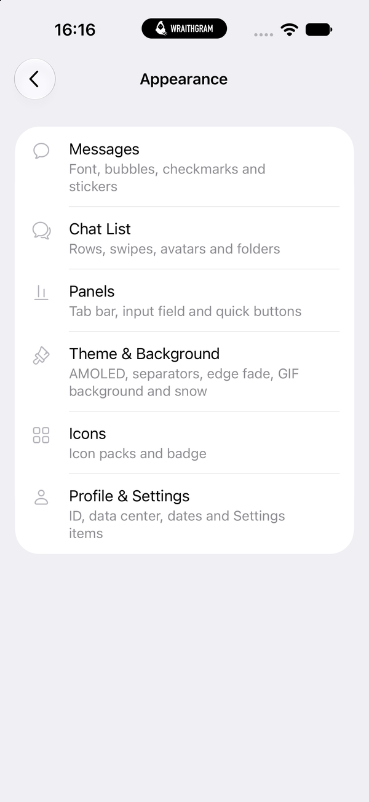

<p align="center">
  
</p>

<div align="center">

# Wraithgram

</div>

<p align="center">
  An unofficial Telegram client with privacy, message history and customization features.
</p>

<p align="center">
  <a href="https://github.com/SkyDeaD/wraithgram/releases"></a>
  
  
  
  <a href="LICENSE"></a>
</p>

<p align="center">
  <b>English</b> · <a href="README.ru.md">Русский</a>
</p>

Wraithgram is built on the official [Telegram iOS](https://github.com/TelegramMessenger/Telegram-iOS) source
code (13.1.2). All of its features are in one menu: **Settings → Wraithgram**. A native macOS version is in
development.

Wraithgram is not affiliated with Telegram.

<p align="center">
  
  
  
  
</p>

## Download

Builds are published on the [Releases](https://github.com/SkyDeaD/wraithgram/releases) page:

- **iOS:** an `.ipa` file. Wraithgram is not in the App Store, so install it with a signing app such as ESign
  or LCSign and your own certificate. It installs next to the official Telegram app.
- **macOS:** a `.dmg` file, once the macOS version is released.

## Features

### Privacy

- **Ghost mode.** Read messages and view stories without marking them read or viewed, hide typing and
  the other activity statuses (recording a voice or video message, sending a photo, choosing a sticker…),
  stay offline or always online. "Read on action" marks a chat read when you reply or react. Exceptions
  by chat, folder or chat type.
- Hide messages from blocked users.
- **Delayed sending:** a pause before text and media go out.
- **Anonymous mode:** a camera mask and a changed voice in one tap.
- **Spoofing:** show another phone number, open a different profile in place of a chosen one. Both are
  local, on your device only.

### Messages

- **Deleted & edited messages.** Deleted messages stay in the chat, edits keep their previous versions.
  Exceptions, automatic clean-up by age, export and import of the history.
- **Restriction bypass:** copy and screenshot protected chats, keep self-destructing and view-once media,
  reveal spoilers, bypass content restrictions, hide sponsored messages.
- **Sending:** word replacement rules, anti-caps, reply with a quote, anonymous stickers, no "via @bot",
  hide "Send as", send with Return.
- **Translation:** Google, Telegram or the system translator, a translate button on messages, translation
  before sending, text in photos.
- **Menu & gestures:** a custom message menu (forward without author, save to Saved Messages or Photos…),
  double tap to edit, bookmarks.
- **Chat export:** one chat or the whole account as HTML and JSON.

### Security

- **Chat protection:** a passcode or Face ID on chosen chats, a secret folder, chats hidden on screenshots
  and screen recordings.
- **Passcode:** more auto-lock options, lock on every launch, lock now.
- **Accounts:** Face ID when switching accounts, separate settings for every account, copy settings from
  another account.

### Media & calls

- **Voice:** a voice changer with presets and your own voice (pitch, timbre, reverb, echo…), an equalizer,
  quoting from Telegram's transcription of voice and video messages.
- **Video messages & camera:** AR masks in video messages and video calls, a mask studio, a photo
  watermark.
- **Calls:** call recording, silent mute, a soundboard, in-call statistics, TCP-only calls, no call rating
  prompts.
- **Downloads & quality:** faster downloads and uploads, large photos, video subtitles from speech
  recognition.

### Appearance

- **Theme & background:** AMOLED, separators, edge fade, an animated GIF background for chats and profiles,
  snowfall.
- **Messages:** fonts (iOS fonts or your own), bubbles, checkmarks, stickers.
- **Chat list:** rows, swipes, avatars, folders.
- **Panels:** tab bar, input field, quick buttons.
- **Icons:** icon packs, a badge under the Dynamic Island.
- **Profile & settings:** user ID, data center, dates, which Settings items are shown.

### More

- **VPN by subscription:** VLESS subscriptions and servers, Telegram goes through your server. The Xray
  core is a separate framework inside the app and is loaded only when the VPN is switched on.
- **Fake gifts:** gifts on your profile that only you see.
- **Extras:** in-app Safari or another browser, picture in picture for YouTube, IP and api_id in sessions,
  "Recent Actions" and "Administrators" in menus, more mute and cache options, no Premium offers.
- **Wraithgram settings:** language, export and import of all settings, reset.

The interface is in English, Russian, Ukrainian and Arabic.

## Building

You need a Mac with Xcode and Python 3. Bazel is downloaded by `build-system/Make/Make.py` on the first
run.

1. Clone the repository with its submodules:

   ```sh
   git clone --recursive -j8 https://github.com/SkyDeaD/wraithgram.git
   cd wraithgram
   ```

2. Create the configuration file and fill in `api_id` and `api_hash` from
   [my.telegram.org](https://my.telegram.org):

   ```sh
   cp build-system/wraithgram-configuration.example.json build-system/wraithgram-configuration.json
   ```

3. Build for the simulator:

   ```sh
   build-system/WGBuild.sh
   ```

   The simulator needs no profiles of your own: without `build-system/wraithgram-codesigning/profiles` the
   script uses Telegram's test profiles from `build-system/fake-codesigning` with an extended expiration
   date. Keep `bundle_id` set to `ph.telegra.Telegraph` for this build.

4. Build an IPA for your iPhone. To sign it on the phone with ESign, LCSign or a similar app:

   ```sh
   build-system/WGBuildResign.sh
   ```

   The result is `build-output/ipa/Wraithgram-for-resign.ipa` with the bundle ID `org.wraithgram.app`. To
   sign on the Mac with your own certificate and profiles instead, see
   [Signing with your own profiles](docs/ios/codesigning.md).

The build scripts pin Bazel to the Xcode chosen with `xcode-select` and apply the patches from
`build-system/WGPatches` to the `rules_apple` and `tgcalls` submodules. The configuration file, the
signing folders and the build output are in `.gitignore`.

### VPN core (optional)

```sh
Wraithgram/Features/Vless/Core/build-core.sh
```

Needs Go 1.26 or newer and the Xcode command line tools; the first run downloads
[Xray-core](https://github.com/XTLS/Xray-core). Without the core the app still builds, and the VPN screen
says that the core is not included.

## Repository structure

```text
wraithgram/
├── Wraithgram/           Wraithgram's code
│   ├── WGCore/           settings, strings, logging (shared, no UI)
│   ├── WGHooks/          the points where Wraithgram connects to Telegram's code
│   ├── WGSettingsUI/     the Wraithgram menu
│   ├── Features/         the features, one module each
│   └── Strings/          translations and their tools
├── build-system/         build scripts (WG*.sh), patches, configuration template
├── docs/ios/             iOS guides: signing, updating to a new Telegram release
└── Telegram/, submodules/, third-party/, …
                          Telegram iOS; kept at the root because its Bazel build expects it
```

Changes to Telegram's own files are kept small, marked `// WRAITH:` and call into `WGHooks`. New Telegram
releases are applied as patches: see [Updating to a new Telegram iOS release](docs/ios/upstream-sync.md).
To contribute, see [Contributing](.github/CONTRIBUTING.md).

## Credits

- [Telegram iOS](https://github.com/TelegramMessenger/Telegram-iOS) by Telegram: Wraithgram is built on its
  source code.
- [ichmagmaus111/ghostgram](https://github.com/ichmagmaus111/ghostgram): the original Ghostgram, which
  Wraithgram is based on. Thank you! Its Telegram community: [channel](https://t.me/ghostgrama),
  [chat](https://t.me/ghostgramchat) and [forum](https://t.me/ghostgramforum).

## License

Wraithgram is distributed under the [GNU General Public License v2](LICENSE), like the Telegram iOS source
code it is based on. Third-party components keep their own licenses; the list is in the app
(**Settings → Wraithgram → About → Third-Party Components**).

If you build your own app from this code, follow Telegram's
[rules for developers](https://github.com/TelegramMessenger/Telegram-iOS#creating-your-telegram-application):
get your own `api_id`, do not call your app Telegram or use its logo, take care of your users' privacy and
publish your code.
